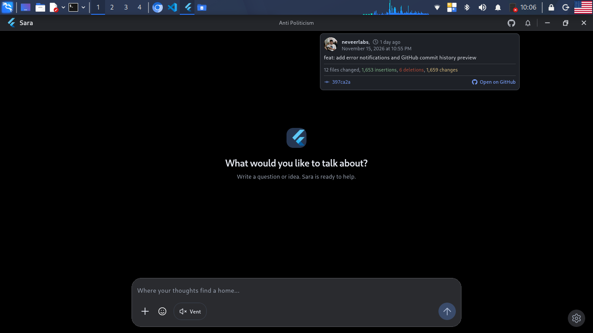
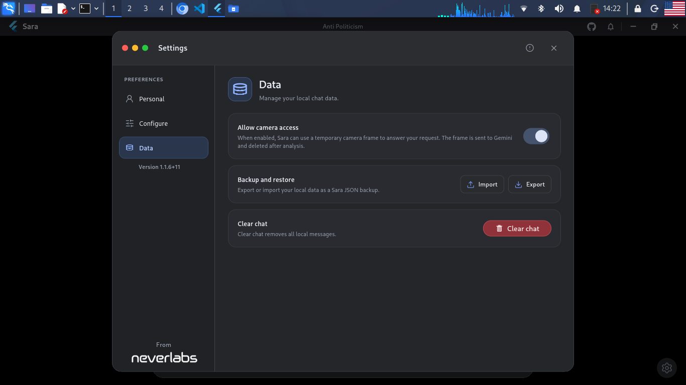

	<h3><b>Sara</b></h3>
	
Sara is a desktop AI chat application for Linux and a close companion for personal conversations.

  
  
  

## Features

- Chat with Gemini; data and conversations are stored locally
- Attach media and files, and scan barcodes from images (images only)
- Read messages aloud, export/import data backups, and manage message branches
- Run Linux commands as the current user
- Search the web

## UI Design

| Room chat | Settings |
|:---:|:---:|
|  |  |

## Privacy

Conversation history is stored locally, and API keys are stored in the Linux `keyring`. Messages for replies and summaries are sent to Google Gemini; search embeddings are generated locally. The required embedding model (about 135 MB) is downloaded once, when first needed.

## Notes

* File/media attachments from the camera or clipboard are automatically deleted after 24 hours
* API keys are stored in the Linux `keyring` (not in the database)
* **Text to Speech** uses **Sound of Text**
* The only AI provider is **Gemini**, using the `gemini-3.5-flash-lite` model
* When **`Allow camera access`** is enabled, the AI can automatically capture images from the device camera
* Likes, dislikes, and reactions are stored in the `message` table
* When **Vent** is active, Sara does not request a Gemini reply, but the background thinker can still send messages for summarization. When Vent is inactive, Gemini may reply or choose not to send a reply
* If sending a message fails (whether due to Gemini or the database), the message is not saved to the database; it remains in the support cache until it can be saved successfully
* Regenerating or editing a message creates a new branch for that message
* The active message branch is stored in the database
* Deleting a user message deletes that message, all its branches and AI replies (including their branches), and all subsequent messages
* Gemini API keys belong to the user; multiple keys can be configured
* AI tool use can increase response time
* Times use **Jakarta Western Indonesian Time (WIB)** (e.g., `Friday, November 13, 2026, 15:35.`)
* Web search providers are Tavily, TinyFish, and Firecrawl

## License

Licensed under the [PolyForm Noncommercial License 1.0.0](https://github.com/neveerlabs/Sara/blob/main/LICENSE)

GitHub icon by [Font Awesome](https://fontawesome.com), licensed under [CC BY 4.0](https://creativecommons.org/licenses/by/4.0/).