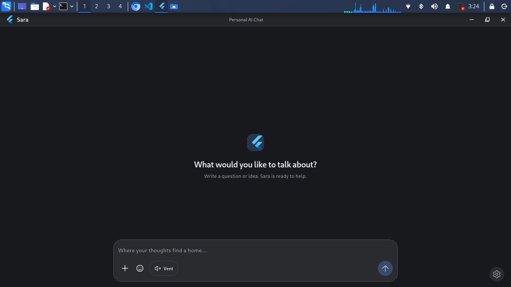
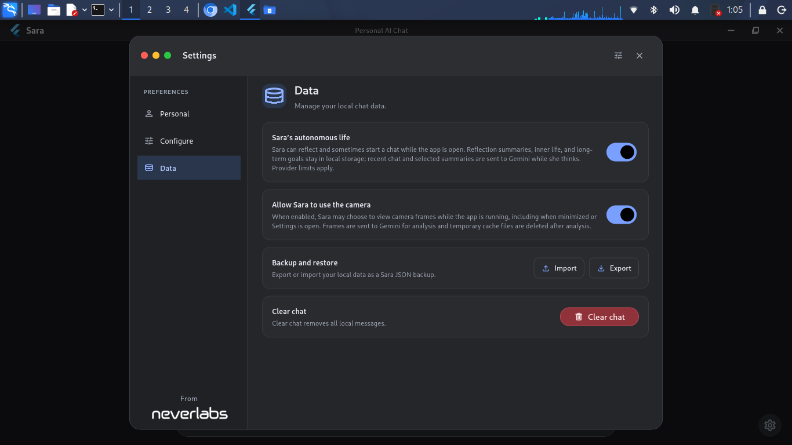

	<h3><b>Sara</b></h3>
	
Sara adalah aplikasi chat AI desktop (Linux) untuk obrolan pribadi—teman dekat yang siap menemani

  
  
  

## Fitur

- Chat AI dengan Gemini, data dan percakapan disimpan lokal
- Lampir media / file, serta pindai barcode dari gambar (image-only)
- Bacakan pesan (speech), export/import backup data, dan kelola cabang pesan (parrent message)
- Run commmand linux dengan bash user
- Melakukan pencarian search web

## Desain UI

| Room chat | Settings |
|:---:|:---:|
|  |  |

## Privasi

Riwayat disimpan lokal dan API key disimpan di `keyring` Linux. Pesan untuk balasan dan ringkasan dikirim ke Google Gemini; embedding pencarian dibuat lokal. Model embedding sekitar 135 MB diunduh sekali saat pertama kali (diperlukan)

## Catatan

* Data lampiran file / media (dari Camera / Clipboard) dihapus otomatis setelah 24 jam
* API Key disimpan di `keyring` Linux (bukan didatabase)
* Fitur **Text to Speech** (speech) menggunakan **Sound of Text**
* Provider yg digunakan hanya **Gemini** dengan model `gemini-3.5-flash-lite`
* Jika tombol **`Allow camera access`** diaktifkan, AI dapat mengambil gambar dari Kamera device secara otomatis
* Rating like/dislike dan reaction disimpan ditabel `message`
* Saat tombol **Vent** aktif, tidak meminta balasan Gemini, tetapi pemikir latar tetap dapat mengirim pesan untuk diringkas. Saat tidak aktif, Gemini boleh membalas atau memilih untuk tidak mengirim balasan
* Jika terjadi error/kegagalan saat kirim pesan (baik dari Gemini atau di database), maka data pesannya tidak disimpan didatabase (melainkan di cache support sampai pesan tersebut sukses)
* Regenerate / Edit pesan akan membuat cabang baru untuk pesan tersebut
* Cabang pesan yg aktif / dibuka disimpan didatabase
* Hapus pesan user akan menghapus semua cabang dan pesan user tersebut,balasan AI (beserta cabangnya jika ada), dan semua pesan setelahnya
* Semua token API model Gemini menggunakan user pribadi (bisa set lebih dari satu API Key)
* Dampak dari AI yg menggunakan tool dapat menjadikan respon balasan lebih lama
* Format waktu yg digunakan ialah format **Jakarta WIB** (e.g., `Jumat, 13 November 2026, 15:35.`)
* Provider search web menggunakan Tavily, Tinyfish dan Firecrawl

## Lisensi

Licensed under the [PolyForm Noncommercial License 1.0.0](https://github.com/neveerlabs/Sara/blob/main/LICENSE)